# The Healthy Lab

**Practical assignment for my Web Programming class:** a full-stack website for a healthy
restaurant, with online ordering, a build-your-own bowl builder, table booking and staff
dashboards.

### [Live demo: healthy-lab-web.vercel.app](https://healthy-lab-web.vercel.app)

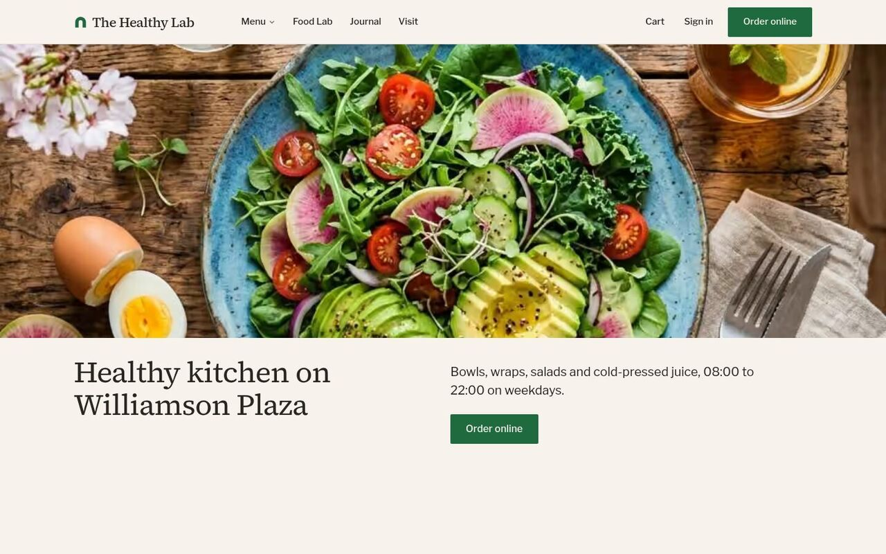

## Live demo

| | |
|---|---|
| Website | https://healthy-lab-web.vercel.app |
| API status | https://healthy-lab-api.vercel.app/health |

Things to try: browse the [menu](https://healthy-lab-web.vercel.app/menu), build a bowl in the
[Food Lab](https://healthy-lab-web.vercel.app/food-lab) (the server prices it as you pick), then
[create an account](https://healthy-lab-web.vercel.app/register) to place an order or
[book a table](https://healthy-lab-web.vercel.app/reservations). The staff dashboards need a staff
account, which is not public on the live demo; run the project locally to try them with the demo
accounts below.

## Architecture

Two apps in one repository, each deployed as its own Vercel project, with Postgres on Supabase:

- **Web** (`apps/web`, Next.js) at https://healthy-lab-web.vercel.app: renders every page and
  forwards `/api/*` to the API.
- **API** (`apps/api`, FastAPI) at https://healthy-lab-api.vercel.app: business rules, sign-in,
  roles and all data access.
- **Database** (Supabase Postgres): orders, menu, payments, bookings, stock and accounts.

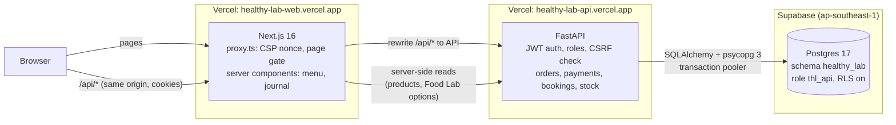

**How a request flows**

1. The browser only talks to the web origin. Pages render on the server; `proxy.ts` gives every
   request a fresh nonce for the Content-Security-Policy and sends signed-out visitors away from
   staff pages.
2. Calls to `/api/*` are rewritten to the FastAPI project, so the session cookies the API sets
   are first-party to the website and no CORS is involved.
3. The API checks the JWT in the cookie, the user's role and (for writes) a CSRF header, then
   works with Postgres through Supabase's pooler as its own database role.

**Sign-in, step by step**

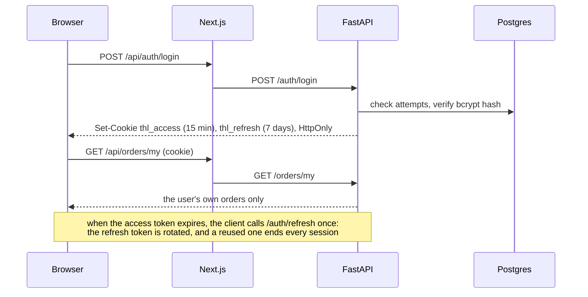

## What it does

- **For guests:** browse the menu with prices, build a custom bowl (priced live by the server),
  order for collection or delivery, book a table or join the walk-in queue, read the journal.
- **For customers with an account:** sign in, see order history and bookings.
- **For staff:** role-based dashboards for the kitchen (order queue, stock, recipes), the cashier
  (payments, reservations, queue), delivery, the dining room and the admin (summary, menu,
  accounts, suppliers).

## Screenshots

| Find us and opening hours | Menu and prices |
|---|---|
| 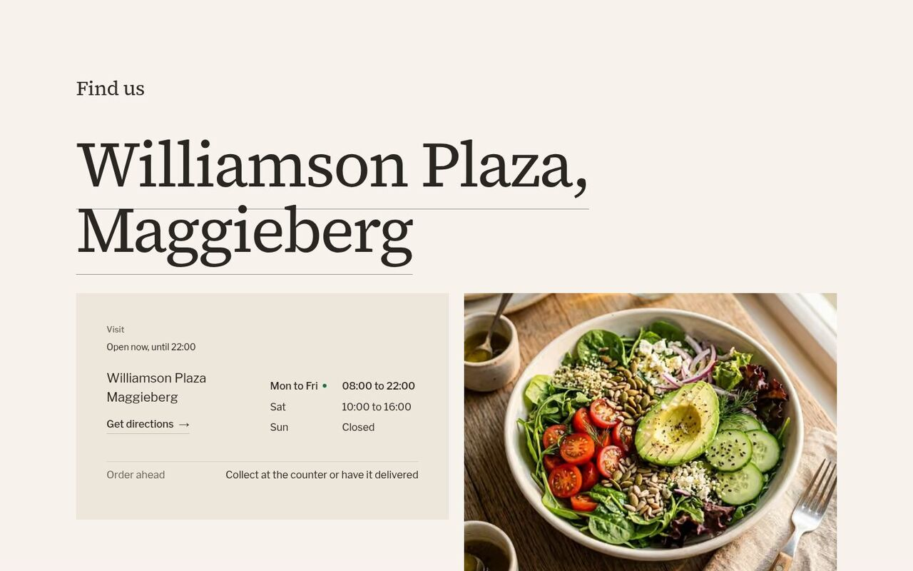 | 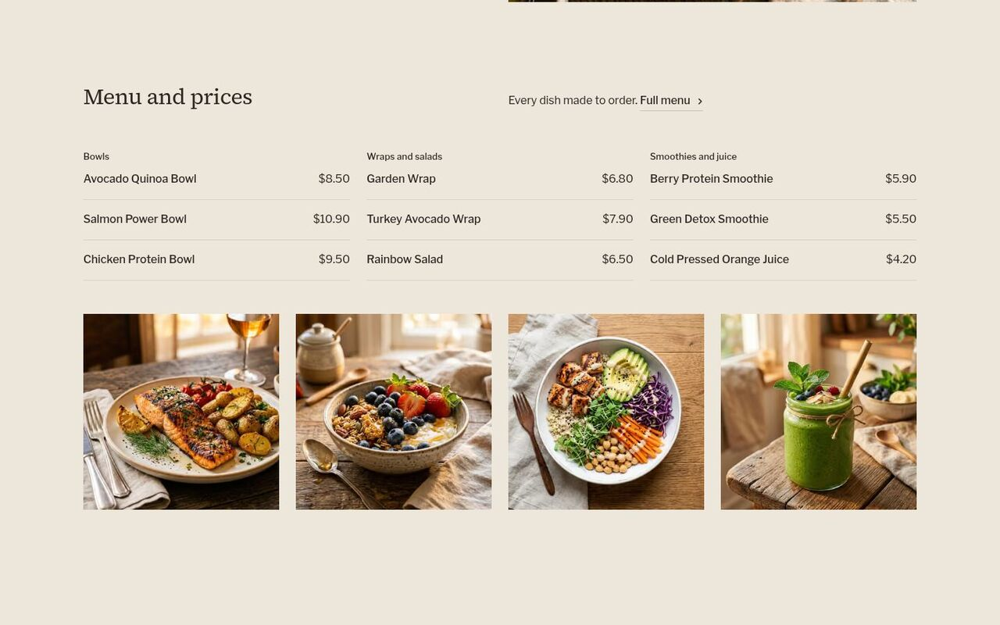 |
| **Full menu** | **Build your own (Food Lab)** |
| 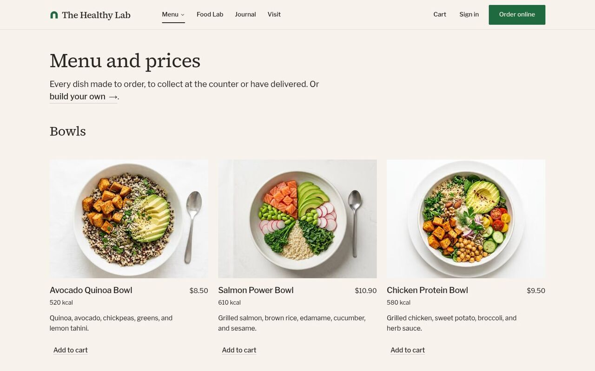 | 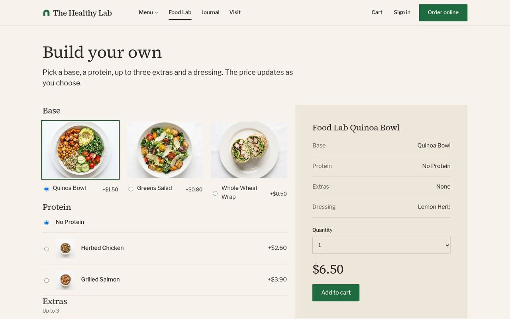 |
| **Journal** | **Kitchen dashboard** |
| 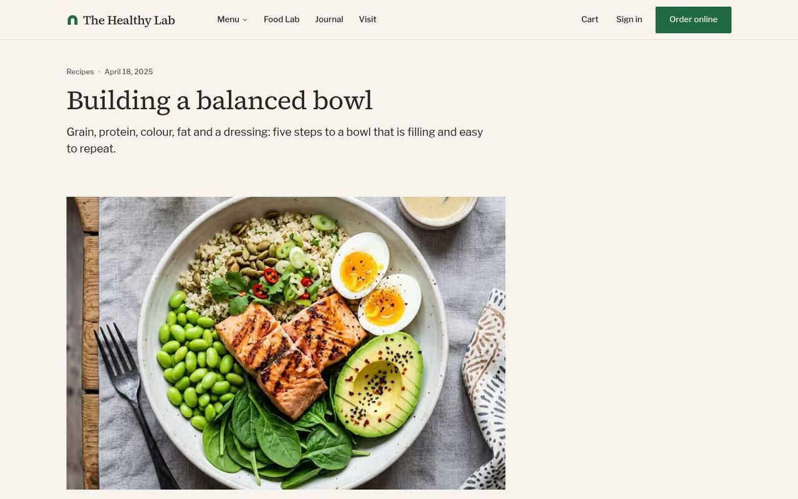 | 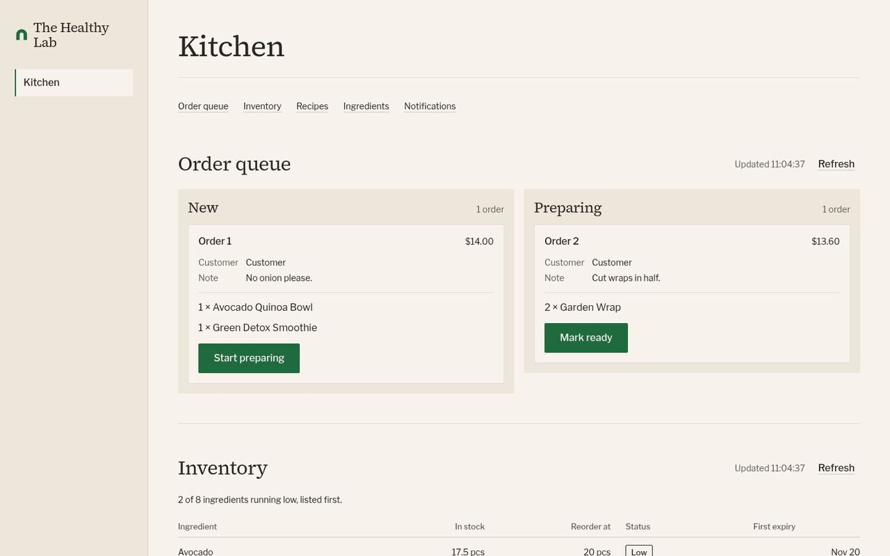 |
| **Admin dashboard** | **On a phone** |
| 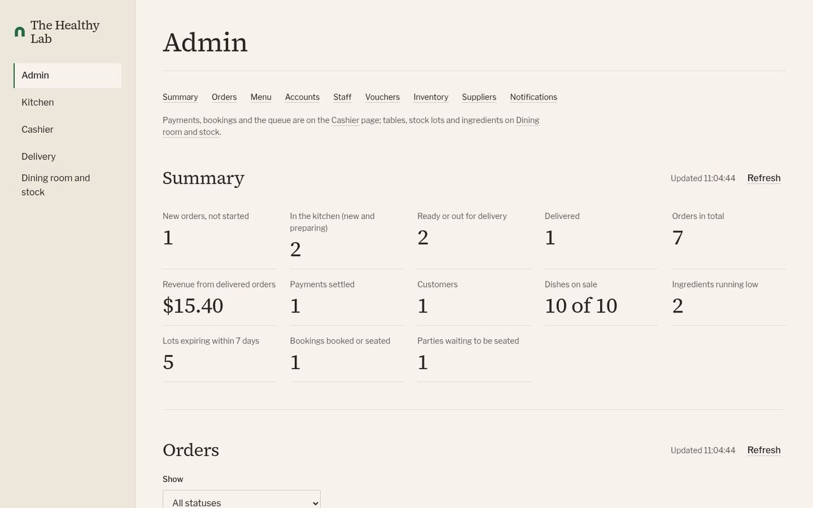 | 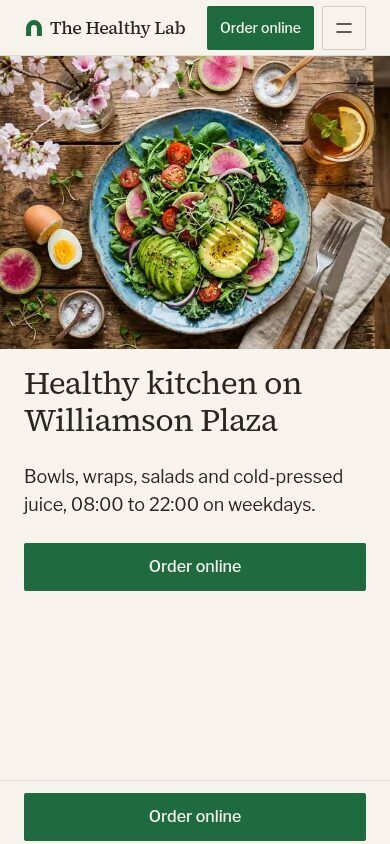 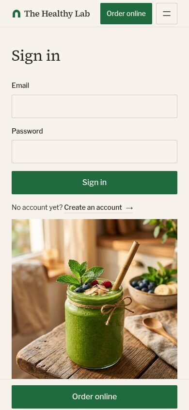 |

## Tech stack

| Layer | Technology | Used for |
|---|---|---|
| Frontend | **Next.js 16** (App Router), **React 19**, **TypeScript** | pages, server rendering, staff dashboards |
| Styling | Plain CSS with a design-token system, CSS modules | one grid, type scale, buttons and colours across the site |
| Fonts and images | `next/font` (Source Serif 4, Libre Franklin), `next/image` | self-hosted fonts, resized AVIF/WebP photos |
| Backend | **FastAPI**, **Pydantic v2**, **SQLAlchemy 2** | REST API, validation, data access |
| Auth | **PyJWT** (HS256), **bcrypt** | access and refresh tokens in httpOnly cookies, password hashing |
| Database | **PostgreSQL 17** on **Supabase** (SQLite for local development) | orders, products, payments, reservations, stock |
| Hosting | **Vercel** (Node.js and Python runtimes) | two projects: web and API |
| Local stack | **Docker Compose** | Postgres + API + web on one machine |
| Quality | **pytest**, **ruff**, **ESLint**, `tsc`, **GitHub Actions** | tests and checks on every push |

## Security

- JWT access (15 min) and refresh (7 days) tokens in `HttpOnly; Secure; SameSite=Lax` cookies;
  page scripts never see a token. Refresh tokens are stored hashed and rotated, and a reused one
  ends every session of that user.
- Writes need an `X-Requested-With: fetch` header (CSRF guard); after 5 failed sign-ins an email is
  locked for 15 minutes.
- Roles are checked by the API on every request; customers only ever see their own orders,
  payments and bookings.
- Per-request nonce Content-Security-Policy, HSTS, frame blocking and a Permissions-Policy on the
  website; strict headers and no `/docs` on the production API.
- The API connects as its own Postgres role in its own schema, with row level security on and
  nothing granted to Supabase's public keys.

The full plan (directory tree, every API endpoint, the security model, deploy steps) is in
[docs/PLAN.md](docs/PLAN.md).

## Repository

```
apps/
  web/                 Next.js app
    app/(site)/        public pages: home, menu, food-lab, cart, orders, reservations, journal, login
    app/dashboard/     staff dashboards: admin, kitchen, cashier, delivery, staff
    components/        site, dashboard and form components
    lib/               API client, auth and cart state, site facts
    proxy.ts           CSP nonce and page gate
    styles/kit/        design system CSS
  api/                 FastAPI app
    main.py            app, middleware, security headers
    auth.py            JWT, cookies, password hashing, login lockout
    routers/           auth, products, orders, payments, restaurant, inventory, admin
    services/          business rules (pricing, stock, memberships)
    tests/             pytest suite
docs/                  PLAN.md and screenshots
docker-compose.yml     local Postgres + API + web
.github/workflows/     CI
```

## Run locally

**Without Docker** (SQLite, fastest):

```bash
cd apps/api && python3 -m venv .venv && .venv/bin/pip install -r requirements-dev.txt
```

```bash
cd apps/api && .venv/bin/python seed.py && COOKIE_SECURE=false .venv/bin/uvicorn main:app --port 8000
```

```bash
cd apps/web && npm install && API_ORIGIN=http://127.0.0.1:8000 npm run dev
```

Open http://localhost:3000. Demo accounts (local seed only), all with password `password123`:
`customer@`, `admin@`, `chef@`, `cashier@`, `delivery@healthylab.test`.

**With Docker** (Postgres):

```bash
docker compose up --build -d
```

```bash
docker compose run --rm api python seed.py
```

## Test

```bash
cd apps/api && .venv/bin/ruff check . && .venv/bin/pytest -q
```

```bash
cd apps/web && npx tsc --noEmit && npx eslint . && npm run build
```

## Deploy

Live on Vercel as two projects from this repository:

| Project | Root | Production URL | Environment variables |
|---|---|---|---|
| `healthy-lab-web` | `apps/web` | https://healthy-lab-web.vercel.app | `API_ORIGIN`, `SITE_URL` |
| `healthy-lab-api` | `apps/api` | https://healthy-lab-api.vercel.app | `DATABASE_URL`, `JWT_SECRET`, `ENV=production` |

Deploy a new version from the app's folder with `npx vercel deploy --prod`. Details in
[docs/PLAN.md, section 6](docs/PLAN.md#6-deploy).

---

Food photographs are the project's own image set. Address, opening hours and prices are sample
data for this class project.
